# Five-Second Browser Concept (`5s-browser`)

**Target Hardware (Locked Single-Target Baseline: HP Mini 210-2000 Series):**  
- **CPU:** Intel Atom N550 ("Pineview-M", 45nm, **2 physical cores / 4 threads** `cpu0..cpu3` @ 1.50 GHz, 2×512 KB L2 cache, 64-bit `x86_64`, `SSSE3` + `MOVBE`, no `SSE4.1+`)  
- **RAM:** **2 GB DDR3** (single 2048 MB SODIMM @ 667 MHz) + **512 MB 4-stream LZ4 `zram0`**  
- **GPU & Display:** Intel GMA 3150 (`8086:a011`, `i915` KMS driver, OpenGL 1.4, no hardware video decode) driving a 10.1" **1024×600** 16-bit RGB565 LVDS panel (`LVDS-1`, `/dev/fb0` = `1,228,800` bytes)  
- **Storage:** 2.5" SATA II drive on Intel NM10 Express (`ahci`, `/dev/sda1`, `ext4` with `noatime`)  
- **Wi-Fi:** Broadcom BCM4313 (`14e4:4727`, mainline `brcmsmac` driver + `firmware-brcm80211`, interface `wlan0`)  
- **OS & Stack:** Debian 12 (Bookworm) `amd64` Minimal + GRUB2 (`GRUB_TIMEOUT=0`) + `5s-init` + `cage` Wayland kiosk compositor + Debian `/usr/bin/chromium`  

**Target Goal:** Power-on to interactive Gmail & YouTube in **≤ 5.0 seconds**, displaying the exact cached state from the last shutdown immediately, while bringing up Wi-Fi and syncing live deltas in the background.  
**Scope:** Single-purpose dual-tab appliance (Tab 1: Gmail, Tab 2: YouTube). Zero general-purpose browser chrome, extensions, or multi-user OS overhead.

---

## 1. Why Standard Browsers Fail the 5-Second Budget on Atom

On an in-order Intel Atom CPU (~400–600 PassMark single-thread), a modern Linux desktop + Chromium cold start takes **25–45 seconds**:
1. **BIOS + Bootloader + Generic Initramfs + Systemd:** 12–20 s waiting on device probing, udev, D-Bus, NetworkManager, and display managers.
2. **Chromium Cold Initialization:** 8–15 s spawning zygote/renderer/GPU processes, parsing multi-megabyte V8 JS bundles for Gmail and YouTube, and compiling bytecode.
3. **Network-Blocked First Paint:** Standard web apps wait for DNS, TLS 1.3 handshakes, and API payloads before rendering meaningful UI—which fails completely if Wi-Fi association + DHCP takes 3–6 seconds.

To hit **5 seconds**, we must **decouple UI display from both OS initialization and JS/network execution**.

---

## 2. The 5-Second Time Budget

We split the 5,000 ms budget into two parallel tracks isolated across the Atom N550's two physical cores: **Track A (Physical Core 0: CPUs `0, 2`)** and **Track B (Physical Core 1: CPUs `1, 3`)**.

```mermaid
flowchart LR
    subgraph TrackA["Track A: Physical Core 0 (CPUs 0,2) — Critical UI Path"]
        T0["0.0s: BIOS + GRUB2 (TIMEOUT=0)"] --> T1["1.5s: Kernel + i915 KMS (/dev/fb0)"]
        T1 --> T2["1.8s: 5s-fb-splash mmap (/var/cache/5s/last_frame.fb)"]
        T2 --> T3["3.4s: Cage + Chromium (No-GPU + V8 Code Cache)"]
        T3 --> T4["4.8s: Interactive Cached DOM (Gmail & YouTube Ready)"]
    end

    subgraph TrackB["Track B: Physical Core 1 (CPUs 1,3) — Async Network & Cache"]
        N1["1.6s: cache_proxy.py (SQLite WAL) + Cached Lease/DNS"] --> N2["3.2s: iwd wlan0 Associated (BCM4313)"]
        N2 --> N3["4.5s+: POST /__5s__/net-online -> Background Delta Sync"]
        N3 --> N4["6.0s+: Seamless DOM Patch (New Emails & Video Feed)"]
    end

    T4 -. "Non-blocking local HTTP hits (<5ms)" .-> N1
```



| Timestamp | Milestone | Budget | Locked Mechanism |
| :--- | :--- | :--- | :--- |
| **0.0 – 0.8 s** | Firmware / Bootloader | 800 ms | Fast BIOS + **GRUB2 (`GRUB_TIMEOUT=0`)** direct kernel boot. |
| **0.8 – 1.8 s** | Kernel + KMS Init | 1,000 ms | Linux kernel with `i915.fastboot=1 video=LVDS-1:1024x600@60e quiet loglevel=0 mitigations=off init=/opt/5s-browser/bin/5s-init`. |
| **1.8 – 2.0 s** | **Visual Ready (0-Latency Frame)** | 200 ms | `5s-init` invokes `5s-fb-splash --restore /var/cache/5s/last_frame.fb`, `mmap`ing `1,228,800` bytes directly to `/dev/fb0`. User sees their exact screen from shutdown at **2.0 seconds**. |
| **2.0 – 4.8 s** | **Interactive Cached Browser** | 2,800 ms | On **Physical Core 0 (`cpus 0,2`)**, launch `cage -s -- /usr/bin/chromium` with `--disable-gpu --v8-cache-options=code` against local `cache_proxy.py` (`127.0.0.1:8555/app`). |
| **1.6 – 6.0 s+** | **Background Wi-Fi + Data Sync** | Parallel | On **Physical Core 1 (`cpus 1,3`)**, `5s-net-fast.sh` pre-applies cached IP/DNS, associates `wlan0` via `iwd`, and triggers `cache_proxy.py` background delta sync. |

---

## 3. Core Architecture Pillars (Single Locked Configuration Per Component)

### Pillar 1: Ultra-Minimal Appliance OS ("Kernel-to-Kiosk")
No desktop environment, no display manager (GDM/LightDM), no NetworkManager bloat on the critical path.
- **Bootloader & Kernel Command Line:** Standard Debian 12 **GRUB2** configured with `GRUB_TIMEOUT=0` and `init=/opt/5s-browser/bin/5s-init`.
- **Dual-Core / 4-Thread Physical Core Isolation (`5s-init`):** The **Atom N550 has 2 physical cores (4 logical CPUs) with separate 512 KB L2 caches**. Our C `PID 1` (`/opt/5s-browser/bin/5s-init`) enforces a hard split:
  1. Mounts virtual filesystems (`proc`, `sys`, `devtmpfs`, `run`) and remounts `/` and `/var/cache/5s` (`noatime`), then activates the **512 MB 4-stream LZ4 `zram0`** swap device.
  2. Immediately `mmap()`s `/var/cache/5s/last_frame.fb` (`1,228,800` bytes, 1024×600 RGB565) into `/dev/fb0` (`i915` inteldrmfb) so the panel displays the last shutdown's exact pixels at ~1.8s.
  3. **Physical Core 0 (Logical CPUs `0, 2`):** Pins **Track A (`cage` + `/usr/bin/chromium`)** at high priority (`nice -10`), keeping the entire 512 KB L2 cache of Core 0 dedicated to V8 and 2D Skia layout.
  4. **Physical Core 1 (Logical CPUs `1, 3`):** Pins **Track B (`cache_proxy.py` + `5s-net-fast.sh` + `iwd` + `dhcpcd`)** so SQLite queries and network handshakes never steal cycles or L2 cache lines from Core 0.

### Pillar 2: Deterministic Shutdown Checkpoint & V8 Code Cache
With **2 GB DDR3 RAM** and a persistent V8 full bytecode cache + SQLite WAL HTTP cache, we use a single, 100% deterministic checkpoint pipeline on stock Debian 12 kernels (no experimental kernel `CRIU` patches required):
1. **Step 1 — App State & Storage Flush (300 ms):**
   - `5s-checkpoint.sh --shutdown` sends `POST http://127.0.0.1:8555/__5s__/snapshot`, flushing the active Gmail inbox state, YouTube feed JSON + thumbnails, and Chromium IndexedDB/V8 bytecode cache (`--v8-cache-options=code`) to `/var/cache/5s/`.
2. **Step 2 — Visual Framebuffer Capture (30 ms):**
   - `5s-fb-splash --capture /var/cache/5s/last_frame.fb` dumps the `1,228,800`-byte 1024×600 RGB565 `/dev/fb0` buffer atomically to disk.
3. **Step 3 — Network Lease & DNS Snapshot (50 ms):**
   - `5s-net-fast.sh --shutdown` writes the current `wlan0` IPv4 address, gateway, SSID/BSSID, and resolved IPs for `mail.google.com`, `www.youtube.com`, `i.ytimg.com`, and `googlevideo.com` to `/var/cache/5s/net/`.

### Pillar 3: Local SQLite WAL Cache Daemon (`cache_proxy.py`)
- Single-file Python 3 daemon (`http.server` + `sqlite3` in `WAL` mode) bound to `127.0.0.1:8555` on **Physical Core 1 (`cpus 1,3`)**:
  - **While Offline (0.0 s – ~4.5 s):**
    - Serves `/app` (the dual-tab Gmail + YouTube appliance shell with `injected_ui.js`) and all cached Gmail/YouTube assets/JSON payloads from `/var/cache/5s/http_cache.sqlite` in **< 5 ms** (`X-5S-Cache: HIT`).
    - Spoofs `navigator.onLine = true` so neither Gmail nor YouTube displays offline error overlays.
    - Displays `● Cached (Connecting...)` in the 24px top status bar.
  - **When `wlan0` Connects (~3.5 s – 5.5 s):**
    - `5s-net-fast.sh` calls `POST http://127.0.0.1:8555/__5s__/net-online`.
    - `cache_proxy.py` fetches live upstream updates in the background, updates SQLite, and pushes delta events over `/__5s__/events` (`Server-Sent Events`) so new emails and videos patch into the live DOM without reloading.
    - Status pill turns `● Live`.

### Pillar 4: Fast-Path Networking on Broadcom BCM4313 (`wlan0`)
- **`iwd` (`iwctl`) on `wlan0`:** Uses pre-saved `/var/lib/iwd/<SSID>.psk` profile and cached frequency/BSSID to associate in `< 1.5 s`.
- **Optimistic IP & Lease Reuse:** On boot, `5s-net-fast.sh` immediately applies the cached IP and default route from `/var/cache/5s/net/last_lease.env` via `ip addr`/`ip route` and launches `dhcpcd -4 -q --noarp wlan0` asynchronously to renew the lease without ARP stall.
- **Pre-Populated `/etc/hosts` Cache:** Merges `/var/cache/5s/net/hosts.cache` into `/etc/hosts` at boot so the first HTTPS request requires zero DNS round-trips.

### Pillar 5: Atom N550 + GMA 3150 + 2 GB DDR3 Tuning
- **ISA & Binary Compilation (`-march=bonnell -mtune=bonnell`):**
  - Compiled for `x86_64` targeting `bonnell` (`SSSE3` + `MOVBE` enabled; `SSE4.1`, `SSE4.2`, and `AVX` explicitly disabled via `-mno-sse4.1 -mno-sse4.2 -mno-avx`).
- **GMA 3150 GPU Process Bypass (`--disable-gpu --disable-gpu-compositing`):**
  - Skips spawning Chromium's GPU process and Mesa `i915_dri.so` shader compiler (saving ~800 ms boot time and ~90 MB RAM), using 4-thread `SSSE3` Skia software rendering directly into the `cage` Wayland KMS framebuffer.
- **Codec Enforcement (`h264ify` in `injected_ui.js`):**
  - Blocks `vp9`, `vp8`, and `av01` in `MediaSource.isTypeSupported()`, forcing YouTube to serve **H.264 (`avc1`) at 360p/480p @ 30fps**, which decodes smoothly across the N550's 4 threads at ~35–45% CPU.
- **2 GB DDR3 Memory Allocation:**
  - Hard-caps Chromium to **2 renderer processes** (`--renderer-process-limit=2 --process-per-site`) with **384 MB V8 heap per renderer** (`--js-flags=--max-old-space-size=384`) + **512 MB 4-stream LZ4 `zram0`**. Fits comfortably inside 2048 MB RAM with zero disk swap activity.

---

## 4. User Experience & Minimal UI Chrome

No URL bar, no bookmarks bar, no settings menus, no window borders.

```text
+------------------------------------------------------------------------+
| [ ✉ Gmail (2 new) ]  [ ▶ YouTube ]              ● Cached -> Syncing... |  <-- 24px hardware-accelerated tab bar
+------------------------------------------------------------------------+
|                                                                        |
|  Inbox                                         [Search mail         ]  |
|  --------------------------------------------------------------------  |
|  ★ Alice Smith      Project update — Looks good for Monday...   10:42  |
|    Bob Jones        Invoice #4821 — Attached is the latest...   Yesterday|
|    YouTube          New upload from Computerphile...            Nov 20 |
|                                                                        |
|  (Instantly scrollable & readable at t = 4.5s from cached IndexedDB;   |
|   new emails stream in at t = 6.0s as background sync completes)       |
|                                                                        |
+------------------------------------------------------------------------+
```

- **Keyboard Shortcuts:**
  - `Alt+1` / `F1`: Switch to Gmail tab (zero re-render, both tabs stay mounted in memory).
  - `Alt+2` / `F2`: Switch to YouTube tab.
  - `Power Button`: Triggers graceful 1.8-second checkpoint & poweroff.

---

## 5. Summary of the Complete Lifecycle

1. **At Shutdown:**
   - Flush Gmail IndexedDB & YouTube feed/thumbnail cache → Dump 1024×600 framebuffer (`/var/cache/5s/last_frame.fb`) → Save DNS/DHCP/TLS 0-RTT state → Checkpoint browser memory image with LZ4 → Power off.
2. **At Power-On (0.0 s – 2.0 s):**
   - Boot stripped LZ4 Linux kernel via EFISTUB → `5s-init` paints `last_frame.fb` to screen at **1.8 s**.
3. **Interactive Offline State (2.0 s – 4.8 s):**
   - Restore browser checkpoint (or hydrated App-Shell + V8 code cache) backed by local Service Worker / disk cache. User can already click, scroll, read cached emails, and browse cached YouTube feed at **4.8 s**.
4. **Background Sync (1.5 s – 6.5 s+):**
   - On the second hyperthread, `iwd` associates on the cached Wi-Fi channel, reuses the last IP lease + cached DNS IPs, fires 0-RTT HTTP/3 requests, and silently patches new emails and fresh YouTube videos into the running UI.
